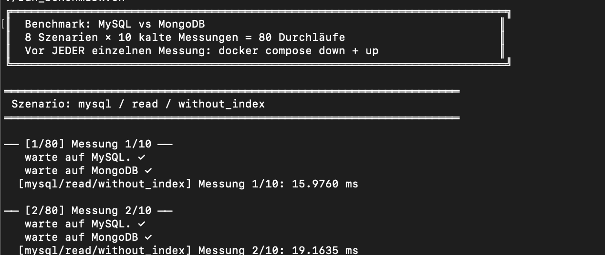
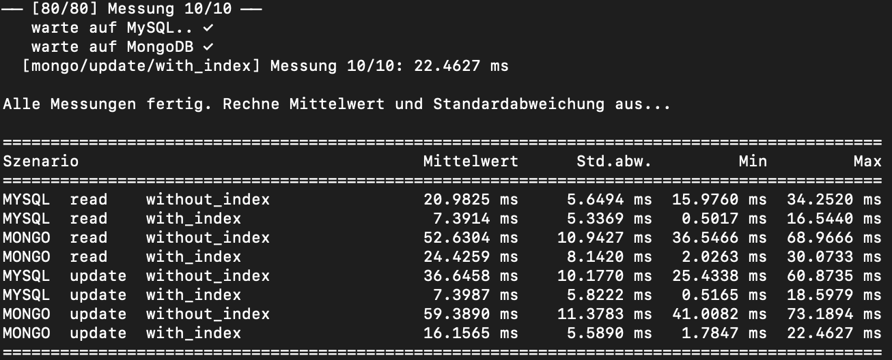

# MySQL vs. MongoDB: Datenmodellierung und Index-Benchmark

[English](README.en.md) · [Setup](docs/SETUP.md) · [Messmethodik](docs/METHODOLOGY.md) · [Lizenz](LICENSE)

Ein praktisches Studienprojekt aus dem NoSQL-Kurs: derselbe Online-Shop als relationales MySQL-Schema und als MongoDB-Dokumentenmodell. Ein Python-Benchmark untersucht, wie ein Index auf der Kundenreferenz Lese- und Update-Operationen beeinflusst.

**Technologien:** Python · SQL · MongoDB · JavaScript · Bash · Docker Compose

Entwickelt von **Yakub Uyar** im 6. Semester. Das Projekt wurde vollständig von ihm umgesetzt. Es ist ein Lern- und Vergleichsprojekt, keine produktiv eingesetzte Shop-Anwendung und hat kein Frontend.

## Was das Projekt zeigt

- Modellierung von 1:1-, 1:n- und n:m-Beziehungen mit Fremdschlüsseln sowie eingebetteten Dokumenten und Referenzen.
- Vergleich von Abfragen mit und ohne sekundären Index bei konstantem Datenbestand und fester Kunden-ID.
- Automatisierung von acht Szenarien mit jeweils zehn Messungen und Auswertung von Mittelwert, Stichproben-Standardabweichung, Minimum und Maximum.
- Einordnung der Ergebnisse mit den Grenzen des Versuchsaufbaus.

## Datenmodell

| Fachliches Objekt | MySQL | MongoDB |
| --- | --- | --- |
| Kunde und Profil | `kunde` und `kundenprofil`, verbunden über einen Fremdschlüssel | `kunden` mit eingebettetem `profil` |
| Produkt und Kategorie | `produkt` und `kategorie` | `produkte` mit eingebetteter `kategorie` |
| Bestellung und Positionen | `bestellung` und `bestellposition` | `bestellungen` mit einem Array `positionen` |
| Kunde einer Bestellung | `bestellung.kundeID` mit Fremdschlüssel im Ausgangsschema | Referenz `bestellungen.kunde_id` |
| Produkt einer Position | `bestellposition.produktID` mit Fremdschlüssel | Referenz `positionen.produkt_id` |

Der mitgelieferte, generierte Testdatenbestand enthält **50.000 Kunden, 50.000 Bestellungen, 500 Produkte, 10 Kategorien und 149.623 Bestellpositionen**. MySQL bildet diese Daten in sechs Tabellen ab; MongoDB in drei Collections mit insgesamt 100.500 Dokumenten. Die Kundendaten dienen ausschließlich als Testdaten.

## Einblicke

Zwei echte Terminalaufnahmen aus der eigenen Kurspräsentation vom April 2026. Sie zeigen den ursprünglichen Lauf mit generierten Testdaten. Die historische Bezeichnung „kalte Messungen“ im ersten Bild bedeutet hier lediglich Messungen nach Container-Neustarts; vollständig leere Caches wurden nicht nachgewiesen. Die Bilder sind keine Aufnahmen eines neuen Prüflaufs.

### Messlauf

Das Shellscript startet die Datenbanken vor jeder Einzelmessung neu und protokolliert das Szenario sowie die gemessene Dauer.



### Auswertung

Mittelwert, Stichproben-Standardabweichung, Minimum und Maximum für alle acht Szenarien.



## Vorhandene Ergebnisse

Aus den [80 ursprünglichen Einzelmessungen](results/bench_results.csv), alle Zeiten in Millisekunden. Diese Werte stammen aus dem ursprünglichen Projektlauf und wurden für diese Veröffentlichung nicht neu gemessen.

Der ursprüngliche MySQL-Lauf verwendete MySQL Connector/Python von Oracle. Der aktuelle Code verwendet aus Lizenzgründen PyMySQL. Neue MySQL-Messungen verwenden damit einen anderen Treiber und sind nicht unmittelbar mit dieser historischen Messreihe vergleichbar.

| Datenbank | Operation | Ohne Index, Mittelwert | Mit Index, Mittelwert |
| --- | --- | ---: | ---: |
| MySQL | Lesen | 20,98 | 7,39 |
| MongoDB | Lesen | 52,63 | 24,43 |
| MySQL | Update | 36,65 | 7,40 |
| MongoDB | Update | 59,39 | 16,16 |

In dieser Messreihe verkürzt ein Index die gemessene Dauer in beiden Systemen. Daraus folgt keine allgemeine Rangfolge der Datenbanken: Datenmodell, Workload, Treiber und Versuchsaufbau beeinflussen das Ergebnis. Die [Methodik und vollständige Statistik](docs/METHODOLOGY.md) erläutern die Einschränkungen.

## Lokal ausführen

Voraussetzungen: Docker mit Compose, Python 3.9 oder neuer und Node.js; für das Shellscript Bash, etwa unter macOS, Linux oder WSL. Alle Befehle werden im Projektordner ausgeführt.

```bash
python3 -m venv .venv
source .venv/bin/activate
python3 -m pip install -r requirements.txt
docker compose up -d
```

Anschließend die Datenbanken nach [docs/SETUP.md](docs/SETUP.md) befüllen und prüfen. Erst danach:

```bash
bash run_benchmark.sh
```

Das Script führt 80 Container-Neustarts aus und druckt anschließend die Statistik. Neue Messwerte liegen in `/tmp/bench_results.csv`; ein weiterer Lauf ersetzt diese Datei. Die Referenzmessungen in `results/` bleiben erhalten.

**Nur mit dieser lokalen Testdatenbank ausführen:** Der Benchmark verändert Bestellstatus, Indizes und im MySQL-Szenario ohne Index den Fremdschlüssel auf `bestellung.kundeID`. Updates werden zwischen den Messungen nicht zurückgesetzt. Die Datenbankports sind an `127.0.0.1` gebunden; das feste MySQL-Passwort `root` und MongoDB ohne Authentifizierung sind nur für diese lokale Testumgebung vorgesehen.

## Statische Prüfungen und Grenzen

Es gibt keinen Anwendungsbuild und keine grafische Oberfläche. Die automatischen GitHub-Prüfungen kontrollieren Syntax und lokale Dokumentationslinks, ohne Datenbanken zu starten:

```bash
python3 -m py_compile benchmark.py summarize.py
bash -n run_benchmark.sh
node --check convert_seed.js
```

Für diese Veröffentlichung wurden Datenbasis, vorhandene Statistik und Dateikonsistenz geprüft. Auf Wunsch des Autors wurde kein neuer Docker- oder Funktionstest durchgeführt. Ein erfolgreicher statischer Check belegt keine fehlerfreie Datenbankausführung. Der Benchmark ist ein begrenztes Experiment; bekannte Grenzen stehen in der [Messmethodik](docs/METHODOLOGY.md).

Die Treiberumstellung auf PyMySQL wurde ebenfalls nicht gegen eine laufende Datenbank getestet. Das Paket wird mit der RSA-Erweiterung installiert, die für die MySQL-8-Passwortauthentifizierung benötigt werden kann.

## Dateien

| Datei | Zweck |
| --- | --- |
| `docker-compose.yml` | MySQL 8.0 und MongoDB 7.0 mit persistenten Volumes |
| `onlineshop_schema.sql` | Tabellen, Datentypen und Fremdschlüssel |
| `onlineshop_mysql_testdaten.sql` | Generierte relationale Testdaten |
| `mongodb_testdaten_onlineshop.js` | Generierte Dokumente für MongoDB |
| `convert_seed.js` | Konvertiert den MongoDB-Seed für den Import in JSONL |
| `benchmark.py` | Misst eine Operation für ein Szenario |
| `run_benchmark.sh` | Neustarts, Bereitschaftsprüfung und Messläufe |
| `summarize.py` | Wertet die neue Messreihe aus `/tmp/bench_results.csv` aus |
| `requirements.txt` | Festgelegte Python-Treiberversionen für neue Läufe |
| `docs/` | Setup und fachliche Einordnung |
| `results/bench_results.csv` | Unveränderte Rohdaten der ursprünglichen Messreihe |

JSONL-Exporte werden lokal erzeugt und nicht zusätzlich versioniert. Die vollständigen Seeds bleiben enthalten, damit die Datenbasis verfügbar ist. Persönliche Kursunterlagen, Entwürfe und Vorführungsnotizen gehören nicht zu dieser öffentlichen Projektauswahl.

## Historie

Die Git-Historie erhält den echten ersten GitHub-Upload vom **13. April 2026** mit seinem ursprünglichen ZIP-Inhalt und den ursprünglichen Zeitpunkten. Die private Autorenadresse wurde durch die GitHub-noreply-Adresse ersetzt; deshalb änderte sich die Commit-ID und die alte GitHub-Signatur wurde entfernt. Die ZIP-Datei gehört nur noch zum historischen Stand. Frühere Entwicklung ohne Git wurde nicht durch erfundene Commits nachgebildet.

## Lizenz und Verantwortung

Copyright © 2026 **Yakub Uyar**. Eigener Code und eigene Inhalte werden unter [eigenen deutschen und englischen Bedingungen](LICENSE) veröffentlicht. Ansehen, Herunterladen, eigene Nutzung, Anpassung und kostenlose Weitergabe unter Erhalt der Bedingungen sind erlaubt. Vereine und Unternehmen dürfen das Projekt für ihre eigene Arbeit verwenden und damit eigene wirtschaftliche Tätigkeiten unterstützen.

Der Verkauf der Software oder abgeleiteter Versionen sowie kostenpflichtige Softwaredienste bedürfen ausdrücklicher Erlaubnis. Diese Bedingungen sind **keine Open-Source-Lizenz** im üblichen Sinn. Rechte und Pflichten für Drittanbieterkomponenten bleiben bestehen; siehe [Drittanbieterhinweise](THIRD_PARTY.md).

Nutzung auf eigene Verantwortung und im vorhandenen Zustand, ohne zugesagte Wartung, Unterstützung oder Gewährleistung, soweit gesetzlich zulässig. Vor realer Nutzung müssen Betreiber Eignung, Funktion, Sicherheit, Datenschutz und einschlägige Anforderungen prüfen. Sie verantworten Einrichtung, Betrieb, Zugriffsrechte, Datensicherung und Wiederherstellung. Zwingende gesetzliche Haftung bleibt unberührt. Maßgeblich sind die vollständigen Bedingungen in [LICENSE](LICENSE).
